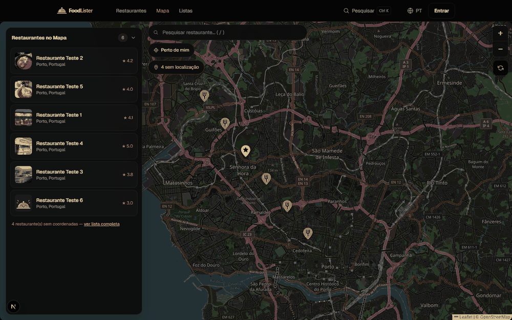
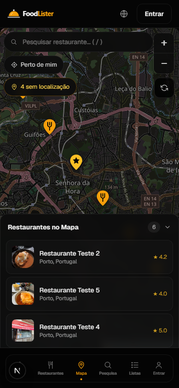
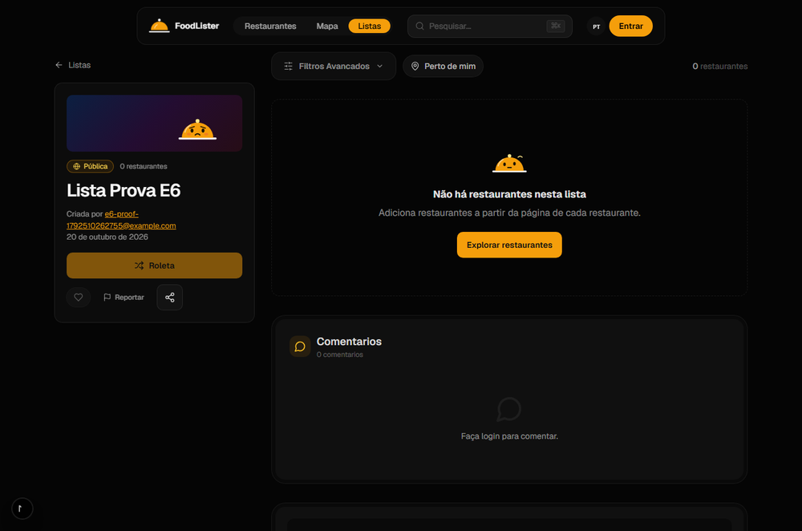

<div align="center">

<picture>
  <source media="(prefers-color-scheme: dark)" srcset="public/brand/lockup-dark.svg">
  
</picture>


**Descobre restaurantes, organiza-os em listas e partilha-as com quem comes.**

</div>

## O que é

FoodLister é uma app web (PWA) para descobrir restaurantes, criar listas curadas, avaliá-los e planear refeições em grupo. Next.js 15 (App Router) sobre Supabase, com subscrições Stripe e conteúdos de marketing gerados por IA.

## Ecrãs

| Mapa (desktop) | Mapa (mobile) |
|---|---|
|  |  |



## Funcionalidades

- **Descoberta:** pesquisa global (Cmd+K), filtros avançados, restaurantes próximos, mapa e roleta.
- **Listas:** privadas ou partilhadas, com colaboradores, comentários e exportação (CSV, JSON, texto).
- **Social:** avaliações, perfis, visitas e refeições agendadas com participantes.
- **Conta e negócio:** notificações (in-app, email, push), planos Free/Premium/Pro com Stripe, painel de administração.
- **Marketing IA:** campanhas e publicações geradas com OpenAI.

## Stack

Next.js 15 · React 19 · TypeScript · Tailwind 3 · Supabase (Postgres + RLS + Auth) · Cloudinary · Stripe · OpenAI · Web Push · Jest, Playwright e Storybook · Vercel.

## Arranque rápido

Requisitos: Node.js 18+, Docker (Supabase local) e a CLI do Supabase.

```bash
git clone https://github.com/BMSaiko/FoodLister.git
cd FoodLister
npm install
npm run db:start      # Supabase local
npm run db:reset      # migrations + seeds
npm run dev           # http://localhost:3000
```

Cria `.env.local` na raiz. Obrigatórias: `NEXT_PUBLIC_SUPABASE_URL`, `NEXT_PUBLIC_SUPABASE_ANON_KEY`, `SUPABASE_SERVICE_ROLE_KEY`, `NEXT_PUBLIC_APP_URL`. Opcionais: `CLOUDINARY_*` (imagens), `STRIPE_*` (pagamentos), `OPENAI_API_KEY` (IA), `NEXT_PUBLIC_VAPID_PUBLIC_KEY` e `VAPID_PRIVATE_KEY` (push). Nunca faças commit deste ficheiro.

## Scripts

| Comando | Para quê |
|---|---|
| `npm run dev` / `build` / `start` | Desenvolvimento, build e produção |
| `npm run lint` / `typecheck` | ESLint e TypeScript |
| `npm test` / `test:coverage` | Jest |
| `npm run e2e` | Playwright |
| `npm run storybook` | Storybook na porta 6006 |
| `npm run db:start` / `db:stop` / `db:reset` / `db:diff` | Supabase local |
| `npm run db:backup` / `db:restore-test` / `db:promote` | Backup, teste de restauro e promoção para o cloud |

## Estrutura

```
app/          rotas (App Router) e endpoints em app/api
components/   componentes React (ui, loading, subscription, ...)
contexts/     Auth, filtros e modais
hooks/        hooks de dados e de funcionalidades
libs/         cache, Stripe, IA, subscrições
supabase/     migrations, seeds e configuração local
public/       marca (brand), mascote (mascot), ícones PWA e service worker
__tests__/    Jest · e2e/ Playwright
docs/         documentação
```

## Tovi, a mascote

  

Tovi é a cloche do logo, com cara. Aparece onde a app espera, está vazia ou falha: carregamentos (`ToviLoader`), estados vazios, erros 404/500, roleta e toasts de sucesso. Emotes em `public/mascot/`; regras em [docs/guides/brand-mascote.md](docs/guides/brand-mascote.md).

## Documentação

Índice completo em [docs/INDEX.md](docs/INDEX.md).

- [Arquitetura](docs/ARCHITECTURE.md) · [PRD](docs/PRD.md) · [Design system](docs/DESIGN_SYSTEM.md)
- [API](docs/api/api-endpoints-reference.md) · [Base de dados](docs/database/database-schema-reference.md)
- Guias: [Git](docs/guides/git-workflow.md) · [Supabase](docs/guides/supabase-workflow.md) · [Desenvolvimento](docs/guides/development-guide.md) · [Deploy](docs/guides/deployment-guide.md) · [Contribuir](docs/guides/contribution-guide.md)
- [Changelog](CHANGELOG.md)

## Licença

Privado e proprietário. Todos os direitos reservados.
