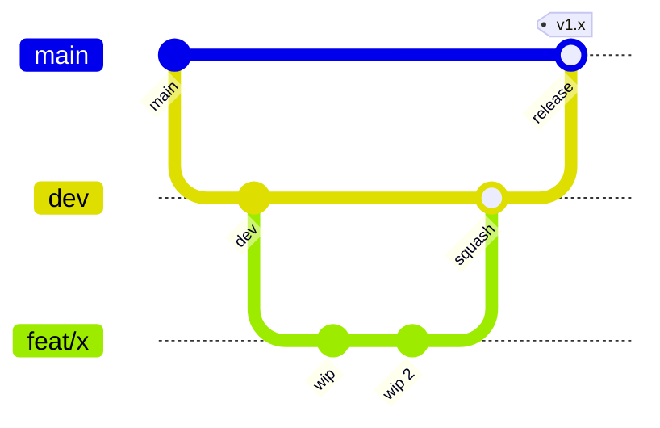

# Workflow Git

Fonte de verdade para humanos e agentes (Claude Code segue este guia sempre que desenvolve o FoodLister).

## Ramos

| Ramo | Papel | Protegido |
|------|-------|-----------|
| `main` | Produção (Vercel). Só recebe PR de `dev` ou `hotfix/*`. | Sim |
| `dev` | Integração. Só recebe PR de ramos de trabalho. | Sim |
| `feat/<slug>` `fix/<slug>` `docs/<slug>` `chore/<slug>` | Trabalho, nascem sempre de `dev`. | Não |
| `hotfix/<slug>` | Correção urgente, nasce de `main`. | Não |

`<slug>` em minúsculas com hífens (`feat/mapa-clusters`). Ramos de trabalho apagam-se após o merge. Ramos antigos com trabalho não integrado arquivam-se como tag `archive/<nome>` antes de apagar.

## Diagrama

## Ciclo de uma feature

1. `git switch dev && git pull --ff-only`
2. `git switch -c feat/<slug>`
3. Desenvolver contra o Supabase local (ver `supabase-workflow.md`); commits pequenos.
4. Antes do PR: `npm run lint`, `npm run typecheck`, `npm test` verdes.
5. `git push -u origin feat/<slug>` e abrir PR para `dev`.
6. CI verde, merge com **squash** (título = Conventional Commit); apagar o ramo.

## Release (`dev` → `main`)

Só quando o BMS disser que `dev` está operacional. PR `dev`→`main` com **merge commit** (preserva o histórico). Preview Vercel corre neste PR; produção corre no push a `main`. `.releaserc.json` gera versão e CHANGELOG. Migrations para o cloud são promovidas à parte, pelo BMS, com backup prévio.

## Hotfix

`git switch -c hotfix/<slug> main` → PR para `main` → depois PR (ou merge) de `main` para `dev` para não divergir.

## Commits

- Conventional Commits: `feat|fix|docs|chore|refactor|test|perf(<área>): assunto` (≤72 caracteres, imperativo).
- Autor: `Bruno Silva <1221514@isep.ipp.pt>`; nunca alterar `user.name`/`user.email`.
- Sem `Co-Authored-By` nem atribuição a agentes em commits ou PRs.
- Stage explícito (`git add <ficheiros>`), nunca `git add .`; nunca `--force`.

## Regras para o Claude Code

- Trabalhar sempre num ramo `feat|fix|docs|chore/<slug>` criado de `dev`; nunca commitar em `main` nem `dev`.
- Commit, push, PR e merge só com pedido do BMS no momento (`AskUserQuestion`).
- Não escrever no Supabase cloud nem apagar ramos remotos sem confirmação explícita.
- Verificar `git rev-parse --abbrev-ref HEAD` antes e depois de operações git.

## CI

- `ci.yml`: push em `main` e `dev`; PR para `dev` e `main`.
- `deploy.yml`: preview Vercel só em PR para `main`; produção só em push a `main`.
- Proteção (PR obrigatório, CI verde, sem force-push) em `main` e `dev` via GitHub.
